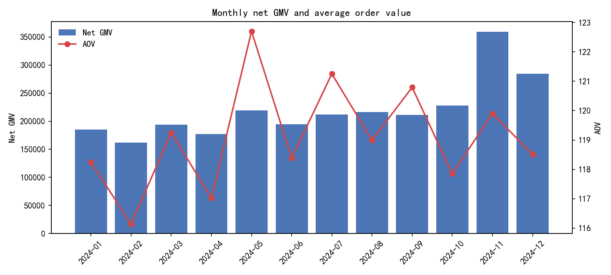
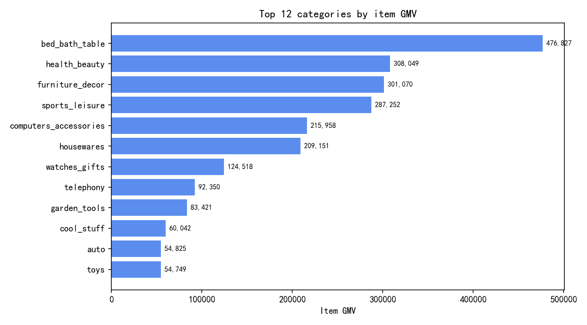
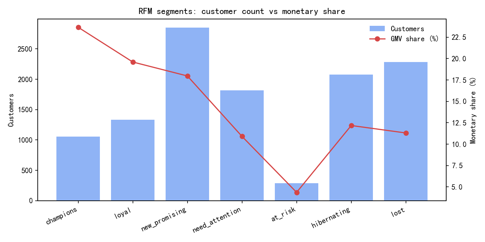
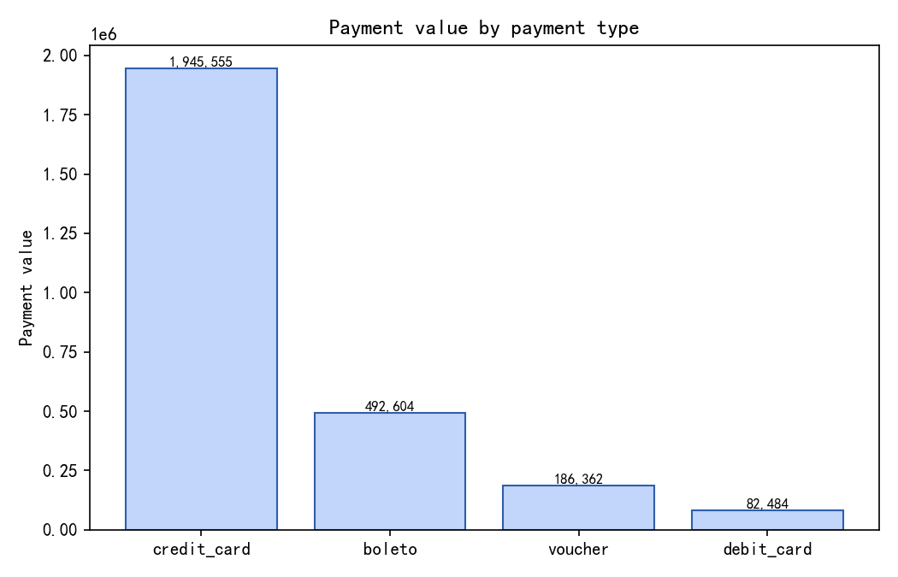

# 电商经营指标体系与用户画像分析

> **数据声明**：本项目使用**完全合成**的电商交易数据（Olist 风格表结构，随机种子 `20240101`），
> 由 `src/ecom/generate.py` 生成，包含 12,000 个用户。所有金额、用户、订单均为程序模拟，
> **不代表任何真实企业或平台的经营数据**。项目目的是演示指标口径设计、SQL 实现、数据质量治理与
> SQL/Pandas 交叉校验方法。

## 1. 核心经营指标

| 指标 | 数值 |
| --- | --- |
| 毛 GMV | 2,707,004.50 |
| 退款金额 | 65,282.98 |
| 净 GMV | 2,641,721.52 |
| 支付订单数 | 22,164 |
| 支付用户数 | 11,705 |
| 复购用户数 | 5,271 |
| 复购率 | 45.03% |
| 客单价 AOV | 119.19 |
| ARPU | 225.69 |
| 退款率 | 2.41% |

## 2. 指标口径

| 指标 | 定义 |
| --- | --- |
| 有效订单 (valid order) | 状态属于 approved/invoiced/processing/shipped/delivered，下单时间不晚于快照日，且至少有一条支付记录。 |
| GMV(毛) | 有效订单 payment_value 之和；反映支付流水口径。 |
| 退款金额 | 有效订单在快照前发生的 refund_value 之和。 |
| GMV(净) | 毛 GMV − 退款金额；AOV、ARPU 均使用净 GMV，避免退款虚增收入。 |
| 支付订单数 | 有效订单的订单号去重计数。 |
| 支付用户数 | 有效订单的 customer_id 去重计数（customer_id 为用户账号粒度，非 customer_unique_id）。 |
| 客单价 AOV | 净 GMV ÷ 支付订单数；分母不含取消/未支付订单。 |
| ARPU | 净 GMV ÷ 支付用户数；分母只含当期有支付行为的用户。 |
| 复购率 | 有效订单数 ≥ 2 的用户数 ÷ 有效订单数 ≥ 1 的用户数；观察窗口内口径，非生命周期复购。 |
| 退款率 | 退款金额 ÷ 毛 GMV。 |
| 品类 GMV | 订单行 price 之和（不含运费），只统计有效订单；运费单列。 |

口径要点：

- **退款处理**：毛 GMV 与净 GMV 分开统计，AOV/ARPU 使用净 GMV；退款只统计快照日之前发生的记录。
- **重复订单**：订单行主键 `(order_id, order_item_id)` 去重；清洗阶段直接隔离含重复行的订单（见第 6 节）。
- **空值**：`customer_id` 为空的订单无法归属用户，直接隔离，不进入任何用户指标。
- **复购率分母**：只含观察窗口内有 ≥1 笔有效订单的用户，属于"窗口复购率"，不是生命周期复购率。

## 3. 月度趋势

| month | paid_orders | paid_users | gross_gmv | refund_amount | net_gmv | aov | mom_growth |
| --- | --- | --- | --- | --- | --- | --- | --- |
| 2024-01 | 1567 | 1479 | 189,646.45 | 4,367.15 | 185,279.30 | 118.24 | — |
| 2024-02 | 1392 | 1318 | 165,490.45 | 3,822.84 | 161,667.61 | 116.14 | -12.74 |
| 2024-03 | 1626 | 1522 | 199,214.61 | 5,306.04 | 193,908.57 | 119.25 | 19.94 |
| 2024-04 | 1511 | 1423 | 180,651.18 | 3,833.27 | 176,817.91 | 117.02 | -8.81 |
| 2024-05 | 1784 | 1660 | 223,771.51 | 4,866.09 | 218,905.42 | 122.70 | 23.80 |
| 2024-06 | 1641 | 1538 | 200,461.08 | 6,193.39 | 194,267.69 | 118.38 | -11.25 |
| 2024-07 | 1750 | 1638 | 217,519.08 | 5,332.12 | 212,186.96 | 121.25 | 9.22 |
| 2024-08 | 1815 | 1698 | 220,629.72 | 4,668.31 | 215,961.41 | 118.99 | 1.78 |
| 2024-09 | 1751 | 1652 | 216,287.50 | 4,789.22 | 211,498.28 | 120.79 | -2.07 |
| 2024-10 | 1931 | 1789 | 234,095.26 | 6,530.16 | 227,565.10 | 117.85 | 7.60 |
| 2024-11 | 2996 | 2688 | 367,537.93 | 8,307.24 | 359,230.69 | 119.90 | 57.86 |
| 2024-12 | 2400 | 2180 | 291,699.73 | 7,267.15 | 284,432.58 | 118.51 | -20.82 |

> `mom_growth` 为环比增速（%），由窗口函数 `LAG(net_gmv)` 计算；首月为空。

## 4. 品类结构

| category | item_gmv | paid_orders | category_aov | gmv_share | cumulative_share |
| --- | --- | --- | --- | --- | --- |
| bed_bath_table | 476,827.39 | 5519 | 86.40 | 19.73 | 19.73 |
| health_beauty | 308,048.91 | 3953 | 77.93 | 12.75 | 32.48 |
| furniture_decor | 301,069.78 | 3681 | 81.79 | 12.46 | 44.94 |
| sports_leisure | 287,251.83 | 3430 | 83.75 | 11.89 | 56.83 |
| computers_accessories | 215,957.75 | 2435 | 88.69 | 8.94 | 65.77 |
| housewares | 209,150.59 | 2392 | 87.44 | 8.66 | 74.42 |
| watches_gifts | 124,518.13 | 1541 | 80.80 | 5.15 | 79.58 |
| telephony | 92,350.25 | 1034 | 89.31 | 3.82 | 83.40 |
| garden_tools | 83,421.39 | 1016 | 82.11 | 3.45 | 86.85 |
| cool_stuff | 60,042.01 | 701 | 85.65 | 2.48 | 89.34 |

> `gmv_share` 与 `cumulative_share` 由 `RANK()` 与累计窗口求和计算，单位为百分比。

## 5. 用户画像（RFM）

| segment | users | user_share | avg_recency_days | avg_frequency | avg_monetary | monetary_share |
| --- | --- | --- | --- | --- | --- | --- |
| champions | 1057 | 9.03 | 28.2 | 4.91 | 591.24 | 23.66 |
| loyal | 1335 | 11.41 | 59.2 | 3.28 | 387.82 | 19.60 |
| new_promising | 2850 | 24.35 | 33.6 | 1.41 | 166.61 | 17.97 |
| need_attention | 1814 | 15.50 | 100.4 | 1.32 | 158.91 | 10.91 |
| at_risk | 288 | 2.46 | 189.8 | 3.41 | 400.62 | 4.37 |
| hibernating | 2078 | 17.75 | 180.7 | 1.28 | 154.81 | 12.18 |
| lost | 2283 | 19.50 | 293.5 | 1.11 | 130.91 | 11.31 |

RFM 打分规则（详见 `docs/rfm_segments.md`）：

- R：距今未购买天数，取全量用户 20/40/60/80 分位切点，天数越少分越高（5→1）。
- F：订单数直接映射，`min(订单数, 5)`，避免大量"仅 1 单"用户被 `NTILE` 任意切分。
- M：净 GMV，取 20/40/60/80 分位切点，金额越高分越高（1–5）。
- 分层：基于 R、F 两个维度的确定性业务规则（`src/ecom/rfm.py::assign_segment`）。

## 6. 数据质量

原始层注入并检测到的问题：

| check | table | severity | rows | description |
| --- | --- | --- | --- | --- |
| duplicate_users | users | high | 5 | customer_id must be unique (duplicate rows in the customer master). |
| duplicate_order_items | order_items | high | 6 | (order_id, order_item_id) must be unique (duplicated line items double-count revenue). |
| missing_customer_id | orders | high | 3 | Every order must reference a customer. |
| orphan_order_customer | orders | high | 4 | order.customer_id must exist in the customer master. |
| orphan_item_product | order_items | high | 4 | order_items.product_id must exist in the product master. |
| negative_item_price | order_items | high | 5 | Line-item price and freight must be non-negative. |
| payment_mismatch_orders | payments | medium | 8 | Payments must reconcile with item + freight totals (orders with corrupted line items excluded). |
| refund_exceeds_payment | refunds | high | 3 | A refund can never exceed the amount actually paid for the order. |
| future_dated_orders | orders | high | 4 | purchase_ts must not be later than the analysis snapshot. |
| orders_without_payment | orders | high | 4 | A revenue-generating order must have at least one payment row. |

清洗策略：**整单隔离**（`src/ecom/clean.py`）。含空 `customer_id`、孤儿外键、未来日期、无支付、
支付对不平、退款大于支付、异常订单行（负价格 / 未知商品 / 重复行）的订单全部进入隔离清单，
不进入指标层。隔离后：原始订单 23,098 单，隔离 41 单，
保留 23,057 单。

## 7. SQL 与 Pandas 交叉校验

同一份清洗后数据分别用 SQL 与 Pandas 计算，逐项比对：

| 校验对象 | 结果 |
| --- | --- |
| 核心指标 | core metrics: 10/10 passed |
| 月度指标 | PASS |
| 品类指标 | PASS |
| 用户级指标 | PASS |
| 复购间隔 | repeat intervals: 3/3 passed |
| RFM 打分数值 | PASS |

（"PASS" 表示差异在容差内：金额 0.011，比率 1e-4，天数 0.02。）

## 8. 可视化

## 9. 局限与后续

1. **合成数据**：订单分布、退款率、季节性均为人为设定，结论不可外推到真实业务。
2. **窗口复购率**：只观察 2024 年内行为，长周期复购需更长的历史数据。
3. **RFM 分层规则**：业务规则而非聚类结果，段位边界需要结合业务目标调整。
4. **用户口径**：以 `customer_id`（账号）为粒度，未合并同一自然人的多账号。
5. **后续**：可接入真实数仓（分区表 + 调度）、增加 cohort 留存与 LTV、对退款原因做细分归因。
